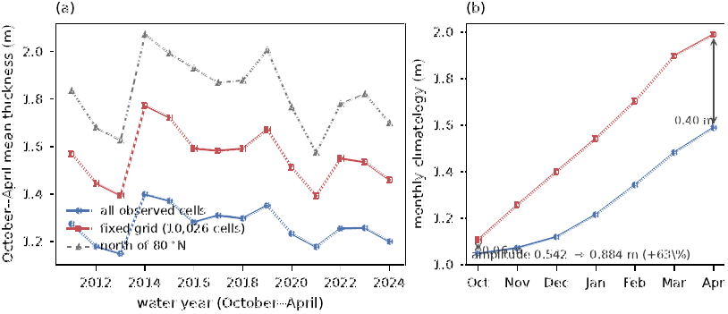

# Sampling conventions for Arctic sea-ice thickness aggregates

  
  

  

Two sampling conventions applied to the same CryoSat-2 record do not give the same
ice: restricting the average to cells observed in at least 90 % of months raises the
mean by 29 cm. That is not an error in either product — it is the difference between
two estimands, and this repository holds the fields and the code that make the
difference reproducible.

*Monthly means under the varying and the fixed-domain convention. The level moves,
the trend does not.*

## What it settles

| quantity | value |
|---|---|
| level shift, fixed minus observed-only | +29.0 cm (+22.9 %) |
| October–April amplitude | 0.542 → 0.884 m (+63 %) |
| trend difference | −0.29 cm per decade (95 % CI −0.92 to +0.15) |
| pooled bias, Pop-A | +0.61 cm |
| pooled bias, Pop-B | +2.72 / +2.52 / +2.65 cm (73 fields / 72 usable / weight-mass) |

## Contents

    data/MPO_CCI_SIT_25km_v1.0.nc   derived fields, 73 months on 432×432 (13.9 MB)
        population_mask, ht_weight_popA/B, bias_popA/B (+ interval, quality flag),
        sea_ice_thickness
    data/mpo_pooled.csv             per-month table written by the script below
    code/reproduce_mpo.py           the four pooled estimates
    code/reproduce_from_tables.py   every other published number
    code/repro_all.py               the CSV record behind each correction
    tables/                         the paper's tables as LaTeX

## Quick start

    pip install numpy pandas scipy netCDF4
    python code/reproduce_mpo.py            # four pooled estimates, PASS/FAIL
    python code/reproduce_from_tables.py    # every table-derived number

    [PASS] A_equal         0.605 cm   paper 0.61
    [PASS] B_equal         2.716 cm   paper 2.72
    [PASS] B_equal_noflag  2.519 cm   paper 2.52
    [PASS] B_mass          2.651 cm   paper 2.65

## Provenance

The raw CCI and CS2SMOS monthly fields are distributed by their providers and are not
redistributed here. The netCDF carries only derived quantities: the observation
indicator, the weights, and the bias with its interval and flag.

## The paper

*Filling, masking and the 29 cm: sampling conventions in Arctic sea-ice thickness
aggregates* — submitted to **Cold Regions Science and Technology**.

## Licence and citation

Code MIT (`LICENSE`), derived fields CC BY 4.0 (`DATA_LICENSE`). Cite the article and
this repository — see `CITATION.cff`.

---
[中文说明](README.zh-CN.md)
