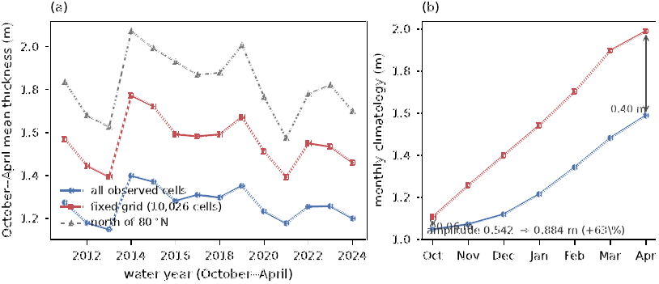

# 北极海冰厚度聚合的采样约定

  

同一份 CryoSat-2 记录，用两种采样约定平均，得到的不是同一片冰：把平均限制在"至少 90 % 月份
有观测"的格点上，均值抬高 29 cm。这不是哪个产品的错误，而是两个估计量之间的差别；本仓提供
让这个差别可复现的字段与代码。

*变域与固定域两种约定下的月均值。水平移动，趋势不动。*

## 它确定了什么

| 量 | 数值 |
|---|---|
| 水平位移（固定域减仅观测） | +29.0 cm（+22.9 %） |
| 十月至四月振幅 | 0.542 → 0.884 m（+63 %） |
| 趋势差 | −0.29 cm/十年（95 % CI −0.92 至 +0.15） |
| Pop-A 合并偏差 | +0.61 cm |
| Pop-B 合并偏差 | +2.72 / +2.52 / +2.65 cm（73 场 / 72 可用 / 权重质量加权） |

## 目录

    data/MPO_CCI_SIT_25km_v1.0.nc   派生场，432×432 上 73 个月（13.9 MB）
        population_mask、ht_weight_popA/B、bias_popA/B（含区间与质量旗标）、sea_ice_thickness
    data/mpo_pooled.csv             下面脚本写出的逐月表
    code/reproduce_mpo.py           四个合并估计
    code/reproduce_from_tables.py   其余全部已发表数字
    code/repro_all.py               每次修订对应的 CSV 记录
    tables/                         论文表格的 LaTeX 源

## 快速开始

    pip install numpy pandas scipy netCDF4
    python code/reproduce_mpo.py            # 四个合并估计，PASS/FAIL
    python code/reproduce_from_tables.py    # 全部表内数字

    [PASS] A_equal         0.605 cm   paper 0.61
    [PASS] B_equal         2.716 cm   paper 2.72
    [PASS] B_equal_noflag  2.519 cm   paper 2.52
    [PASS] B_mass          2.651 cm   paper 2.65

## 数据来源

CCI 与 CS2SMOS 的原始月场由各自提供方分发，本仓不再分发。netCDF 只含派生量：观测指示器、
权重，以及带区间与旗标的偏差。

## 对应论文

*Filling, masking and the 29 cm: sampling conventions in Arctic sea-ice thickness
aggregates*，拟投 **Cold Regions Science and Technology**。

## 许可与引用

代码 MIT（`LICENSE`），派生场 CC BY 4.0（`DATA_LICENSE`）。引用见 `CITATION.cff`。

---
[English](README.md)
